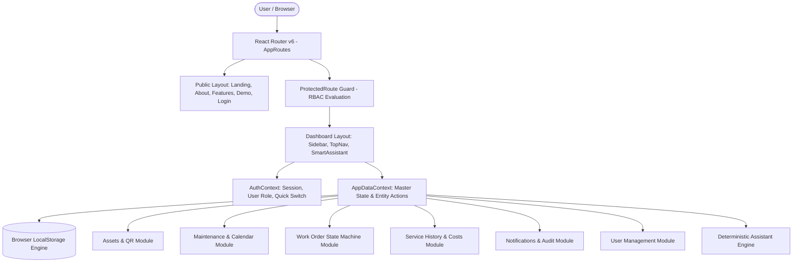

# Project Documentation: Smart AssetCare

## AI-Powered Capital Asset & Predictive Maintenance Management System

---

## A. Project Overview

### Project Name
**Smart AssetCare** – Enterprise Campus Asset & Predictive Maintenance Management Platform

### Project Objective
To provide institutional campus facilities, educational universities, research laboratories, and enterprise operations with a unified, high-reliability command console for physical equipment inventory, preventive maintenance scheduling, work order dispatch, audit-compliant service logs, repair expenditure tracking, and automated asset telemetry health monitoring.

### Problem Being Solved
1. **Unplanned Downtime & Catastrophic Equipment Failures**: Educational and research facilities suffer prolonged downtimes due to reactive, ad-hoc maintenance rather than structured preventive cycles.
2. **Loss of Relational Audit Trail & Deletion Risks**: Premature or unauthorized deletion of physical assets frequently leaves orphaned maintenance tickets, unverified invoices, and corrupted audit logs.
3. **Disjointed Work Order Lifecycles**: Lack of role-enforced state transitions leads to incomplete technical logs, unassigned tickets, and unverified work orders.
4. **Opaque Financial Tracking**: Disconnect between physical servicing and accounting ledgers makes calculating true equipment total cost of ownership (TCO) difficult.

### Target Users
- **Institutional Administrators (ADMIN)**: Executive leadership and directors needing high-level oversight, compliance reporting, user access governance, and master data lifecycle authority.
- **Facility Managers (MANAGER)**: Operational supervisors who coordinate preventive maintenance calendars, dispatch field work orders, verify technician completions, and audit financial expenses.
- **Field Technicians (TECHNICIAN)**: On-site engineers and electricians executing assigned tasks via digital Kanban, logging parts replaced, entering labour costs, and recording technical notes.
- **Faculty & Campus Staff (STAFF)**: Departmental end-users who discover faulty equipment, report maintenance issues, track status updates, and scan physical QR tags.

---

## B. Technology Stack

The Smart AssetCare system is engineered using a modern client-side Single Page Application (SPA) stack:

| Layer | Technology | Version | Purpose |
| :--- | :--- | :--- | :--- |
| **Core Framework** | React | `^18.3.1` | Component-driven UI architecture with hooks and concurrent mode rendering |
| **DOM Renderer** | React DOM | `^18.3.1` | Optimized virtual DOM tree management |
| **Build & Tooling** | Vite | `^5.4.11` | Ultra-fast ES-module bundling, Rollup code splitting, and HMR |
| **Client Routing** | React Router DOM | `^6.28.0` | Declarative client-side routing, protected route guards, and nested layouts |
| **Styling & CSS** | Tailwind CSS | `^3.4.15` | Industrial dark-theme utility design system with custom CSS variables |
| **Post-Processing** | PostCSS & Autoprefixer | `^8.4.49` / `^10.4.20` | Cross-browser CSS compatibility and vendor prefixing |
| **Animation Engine** | Framer Motion | `^11.11.17` | Smooth layout transitions, drawer slide-overs, and modal animations |
| **Iconography** | Lucide React | `^0.460.0` | Accessible, tree-shakeable SVG icon components |
| **Data Visualization** | Recharts | `^2.13.3` | Responsive SVG area, bar, line, and pie charts with custom tooltip formatting |
| **Drag & Drop** | @dnd-kit (core, sortable, utilities) | `^6.1.0` / `^8.0.0` / `^3.2.2` | Accessible, touch-compatible Kanban board drag-and-drop state transitions |
| **QR Generation** | qrcode.react | `^4.1.0` | Dynamic SVG rendering and 512px canvas PNG generation for physical tagging |
| **Date Manipulation** | date-fns & native ISO utilities | `^4.1.0` | Calendar grid generation, recurrence calculation, and overdue date comparison |
| **UI Confetti** | canvas-confetti | `^1.9.3` | Visual confirmation on verification and milestone events |
| **Persistence Engine** | Web Storage API (localStorage) | Native | Versioned, relational JSON storage with fallback error recovery |

*(Note: No external backend server or database is installed. All operations execute client-side with full persistence via browser LocalStorage).*

---

## C. Application Architecture



### 1. Frontend Structure & Component Hierarchy
```
frontend/
├── public/                 # Static assets, SVG favicons
├── src/
│   ├── assets/             # Brand logos and iconography
│   ├── components/         # Modular reusable components
│   │   ├── assistant/      # SmartAssistant floating drawer and rule engine
│   │   ├── cards/          # Card wrappers and MetricCard KPI blocks
│   │   ├── charts/         # Recharts integration wrappers
│   │   ├── common/         # Base Button, Badge, and Tag components
│   │   ├── dashboard/      # Role-specific dashboard layouts
│   │   ├── forms/          # TextInput, SelectInput, SearchInput
│   │   ├── modals/         # Modal and ConfirmDialog components
│   │   └── navigation/     # Sidebar, TopNav, PublicNavbar, PublicFooter
│   ├── context/            # Global state context providers
│   │   ├── AppDataContext.jsx  # Primary relational data store (1,500+ LOC)
│   │   ├── AuthContext.jsx     # Session persistence, RBAC roles, simulated auth
│   │   ├── ThemeContext.jsx    # Theme provider
│   │   └── ToastContext.jsx    # System notifications toast manager
│   ├── data/
│   │   └── seedData.js     # Master demo seeds (Assets, Users, Tickets, Costs)
│   ├── layouts/
│   │   ├── DashboardLayout.jsx # Collapsible sidebar, top nav, prototype banner
│   │   └── PublicLayout.jsx    # Public marketing layout
│   ├── pages/              # Domain views (Assets, Maintenance, WorkOrders, etc.)
│   ├── routes/             # AppRoutes and ProtectedRoute guard
│   ├── services/           # Versioned storageService.js
│   ├── styles/             # Tailwind globals.css, industrial grid, animations.css
│   └── utils/              # Permissions (RBAC), dateHelpers, formatters, workOrderRules
└── package.json
```

### 2. State Management & Data Flow
- `AppDataContext` provides a unified reactive data model across all components.
- State updates use immutable functional updates (`setAppState(prev => ...)`).
- Every state change triggers synchronization to browser `localStorage` (`smartAssetCareDemo_v1`).
- Custom cross-entity hooks guarantee relational integrity:
  - Verifying a work order automatically generates a linked `serviceHistory` and `repairCosts` record.
  - Adding or modifying maintenance schedules automatically recalculates upcoming recurrence cycles and triggers deduplicated notification events.

### 3. Role-Based Access Control (RBAC) Matrix

| Domain / Route | Action / Permission | ADMIN | MANAGER | TECHNICIAN | STAFF |
| :--- | :--- | :---: | :---: | :---: | :---: |
| `/app/dashboard` | Access Tailored Dashboard | Yes | Yes | Yes | Yes |
| `/app/assets` | View Asset Catalog | Yes | Yes | Yes | Yes |
| `/app/assets/new` | Register New Asset | Yes | Yes | No | No |
| `/app/assets/:id` | Edit Asset Master Data | Yes | Yes | No | No |
| `/app/assets/:id` | Permanent Asset Deletion | Yes (Zero Dep Only) | No | No | No |
| `/app/assets/:id` | Archive / Retire Asset | Yes | Yes | No | No |
| `/app/qr-codes` | Download / Print QR Codes | Yes | Yes | No | No |
| `/app/maintenance` | View Preventive Calendar | Yes | Yes | Yes | Yes |
| `/app/maintenance` | Create / Reschedule Task | Yes | Yes | No | No |
| `/app/work-orders` | View Scoped Work Orders | All | All | Assigned Only | Submitted Only |
| `/app/work-orders` | Create Ticket / Report Issue | Yes | Yes | No | Yes |
| `/app/work-orders` | Assign Technician | Yes | Yes | No | No |
| `/app/work-orders` | Start Work / Progress Notes | Yes | Yes | Assigned Only | No |
| `/app/work-orders` | Complete Work Order | Yes | Yes | Assigned Only | No |
| `/app/work-orders` | Verify Work Order | Yes | Yes | No | No |
| `/app/work-orders` | Close & Archive Work Order | Yes | Yes | No | No |
| `/app/service-history`| View & Print Service Logs | Yes | Yes | Yes | Yes |
| `/app/repair-costs` | View Invoices & Costs | Yes | Yes | Yes (Read Only) | No |
| `/app/repair-costs` | Add / Edit Invoices | Yes | Yes | No | No |
| `/app/reports` | View Analytics & Export CSV | Yes | Yes | No | No |
| `/app/notifications` | Notification Center | Yes | Yes | Yes | Yes |
| `/app/users` | Manage User Accounts | Yes | No | No | No |
| `/app/settings` | Factory Demo Reset | Yes | No | No | No |

---

## D. Implemented Modules

### 1. Authentication & Role Management
- Multi-role simulation with quick profile switching (ADMIN, MANAGER, TECHNICIAN, STAFF).
- Password validation using standardized campus demo credentials.
- Automatic account lockout enforcement when accounts are deactivated by administrators.
- Session persistence via `localStorage` (`smartAsset_currentUser_v1`).

### 2. Application Dashboard
- Four distinct, role-tailored dashboard views:
  - **Admin Dashboard**: Executive campus health metrics, capital asset values, active critical incidents, cost distribution, and user status.
  - **Manager Dashboard**: Preventive maintenance schedule due dates, unassigned ticket queue, technician workload balance, and verification pipeline.
  - **Technician Dashboard**: Focused personal workload, tickets in progress, priority alerts, and recent completion timeline.
  - **Staff Dashboard**: Equipment reporting desk, recent personal ticket resolutions, and physical campus asset lookup.

### 3. Asset Inventory & Detail Management
- Full lifecycle tracking: OPERATIONAL, UNDER_MAINTENANCE, OUT_OF_SERVICE, RETIRED.
- Comprehensive specifications: category, brand, model, serial number, purchase cost, warranty dates, location, and department.
- Simulated real-time equipment telemetry health score (0-100%).
- Relational dependency protection preventing accidental deletion of assets with linked historical records.

### 4. Interactive QR Code Passport System
- Dynamic QR code generation for every registered physical asset.
- Deep-linking URL encoding: scans navigate directly to `/app/assets/{assetId}`.
- Dual-rendering engine: high-contrast SVG for on-screen viewing and 512px canvas for printable physical equipment tags and PNG downloads.

### 5. Preventive Maintenance Scheduling
- Dual-view interface: interactive monthly calendar view and searchable tabular list view.
- Effective status calculations: UPCOMING, DUE, OVERDUE, COMPLETED, CANCELLED.
- Recurrence cycle progression (Weekly, Monthly, Quarterly, Half-Yearly, Yearly).
- Automated ticket generation: one-click conversion of scheduled tasks into actionable work orders.

### 6. Work Order Lifecycle State Machine
- Strict state transitions:
  - `CREATED` → `ASSIGNED` → `IN_PROGRESS` → `COMPLETED` → `VERIFIED` → `CLOSED`
- Role-gated action handlers and drag-and-drop Kanban validation.
- Activity audit timeline recording actor, timestamp, status transition, and notes.
- Awaiting verification pipeline with supervisor rework loop (`COMPLETED` → `IN_PROGRESS`).

### 7. Service History Audit Trail
- Automated record creation upon work order management verification.
- Stores problem identified, work performed, technician notes, parts replaced, and manager sign-off remarks.
- Searchable and printable official Service History Certificates with institutional letterhead layout.

### 8. Repair Cost & Expense Ledger
- Itemized financial line items: Labour charges, spare parts consumables, and incidental expenses.
- Real-time mathematical total calculation: `Total Cost = Labour + Parts + Other Charges`.
- Automatic synchronization between expense records and linked service history entries.
- Filtering by date range, asset category, and payment status (PAID, PENDING, OVERDUE).

### 9. Commercial Invoice Management
- Interactive digital invoice viewer with simulated invoice numbers (`INV-2026-XXX`).
- Invoice payment status toggle and file metadata presentation.
- Printable purchase and service invoice vouchers.

### 10. Advanced Analytics & Reports
- Real-time KPI summaries: Asset availability rates, Mean Time to Repair (MTTR), total maintenance expenditure, and technician workload.
- Date range filtering (Today, 7 Days, 30 Days, This Month, This Year, Custom Range).
- Live interactive charts: Recharts Area Chart (monthly expense trend), Bar Chart (spend by asset category), Pie Chart (equipment status distribution).
- Direct client-side CSV report export with sanitization and custom date-stamped filenames.

### 11. Notification Center
- Automated real-time alert generation for maintenance due today, overdue tasks, critical priority work orders, and low asset health scores (<70%).
- Real-time badge counter updating on top navigation and sidebar.
- Read/Unread toggling, mark-all-as-read, and deep-link navigation to affected records.
- Deduplication engine preventing repeated alerts for identical event IDs.

### 12. User Administration
- Complete user management for Institutional Admins.
- User creation with unique email validation, phone validation, and department assignment.
- User deactivation with safety guard preventing deactivation of the sole active administrator.
- Deactivated account lockdown preventing subsequent demo logins or role switching.

### 13. Smart AssetCare Assistant
- Deterministic client-side natural language query engine.
- Calculates answers in real time from live application collections:
  - Operational asset counts and availability percentages.
  - Assets currently requiring maintenance.
  - Overdue preventive maintenance tasks.
  - Pending work orders by status and priority.
  - Total maintenance expenditure and itemized cost breakdown.
  - Asset with the highest recorded repair expense.
  - Technician workload and ticket assignment counts.
  - Low health score equipment telemetry alerts.
- Honest fallback responses for unsupported questions without hallucinated data.

### 14. Settings & Prototype Data Management
- Personal profile display name and phone number editing.
- Factory seed data restoration (`Reset Demo Data to Factory Seeds`) protected by confirmation modal.
- Institutional Admin RBAC restriction enforcing that only authorized administrators can reset database seeds.

---

## E. Demo Login Credentials

The prototype includes pre-configured accounts representing all institutional stakeholders:

| Role | Account Name | Demo Email | Password | Primary Scope & Access |
| :--- | :--- | :--- | :--- | :--- |
| **Institutional Admin** | Dr. Ramesh Sharma | `admin@smartassetcare.demo` | `Demo123!` | Complete system authority, user management, factory reset, full analytics |
| **Facility Manager** | Vikram Malhotra | `manager@smartassetcare.demo` | `Demo123!` | Preventive calendar, technician dispatches, ticket verification, expenses |
| **Field Technician** | Rajesh Kumar | `technician@smartassetcare.demo` | `Demo123!` | Assigned work orders, parts/labour logging, ticket completion |
| **Faculty / Staff** | Prof. Anita Deshmukh | `staff@smartassetcare.demo` | `Demo123!` | Incident reporting, equipment catalog search, personal ticket tracking |

*(Note: Quick-login buttons on the login terminal allow one-click role switching for evaluators).*

---

## F. Installation and Execution

### Prerequisites
- **Node.js**: `v18.0.0` or higher (`v20+` recommended)
- **Package Manager**: `npm` (v9+) or `pnpm`

### Step 1: Clone or Navigate to Project
```bash
cd "c:\Users\nimje\Desktop\smartAsset\smartAsset"
```

### Step 2: Install Frontend Dependencies
```bash
npm --prefix frontend install
```

### Step 3: Run the Development Server
```bash
npm --prefix frontend run dev
```
The application will launch locally at `http://localhost:5173/`.

### Step 4: Run the Production Build
```bash
npm --prefix frontend run build
```
Vite will compile production-ready, minified and chunked assets into `frontend/dist/`.

### Step 5: Preview the Production Build Locally
```bash
npm --prefix frontend run preview
```

### Step 6: Execute Automated E2E Verification Test Suite
```bash
node frontend/verify-e2e.js
```

---

## G. Current Limitations

1. **Client-Side Prototype Architecture**:
   The current application operates purely in the browser. There is no remote backend service; all state operations execute locally on the client machine.
2. **Browser LocalStorage Persistence**:
   Data is stored in browser `localStorage`. Clearing browser cookies/cache or opening private incognito tabs will load a fresh instance of the seed database.
3. **Simulated Authentication**:
   Authentication is simulated client-side for demonstration and project review purposes without cryptographically signed JWTs or server sessions.
4. **Deterministic Rule-Based Assistant**:
   The Smart Assistant uses an internal JavaScript query parser rather than a live external LLM API or backend vector database.
5. **Simulated Equipment Telemetry & Predictive Health**:
   Asset health scores (0-100%) and degradation metrics are simulated representations designed to demonstrate predictive maintenance UX workflows.
6. **No Live Email, SMS, or Push Notifications**:
   Notifications are generated and delivered within the in-app notification center; no external SMTP or SMS gateway is connected.

---

## H. Future Scope

1. **Enterprise Backend Services**:
   Develop a production Java Spring Boot or Go microservices architecture with Spring Security, OAuth2 / JWT authentication, and automated OpenAPI documentation.
2. **Relational Database Migration**:
   Migrate data schema to PostgreSQL with Flyway migrations, connection pooling, and ACID relational integrity.
3. **Real Machine Learning Predictive Maintenance**:
   Integrate real-time time-series telemetry (vibration, temperature, power draw) with Python FastAPI microservices running Scikit-Learn or TensorFlow anomaly detection models.
4. **Physical IoT Sensor Gateways**:
   Deploy MQTT / WebSocket ingestion pipelines connecting edge sensors to institutional equipment.
5. **Cloud Deployment & Containerization**:
   Containerize the application with Docker and Docker Compose; deploy on AWS / GCP / Azure with automated CI/CD pipelines.
6. **Native Mobile Inspection App**:
   Build a cross-platform React Native or Flutter mobile application for technicians featuring offline barcode/QR scanning and photo attachments.
7. **Omnichannel Notification Delivery**:
   Integrate Twilio for SMS dispatch, SendGrid for institutional email alerts, and Firebase Cloud Messaging (FCM) for mobile push notifications.
