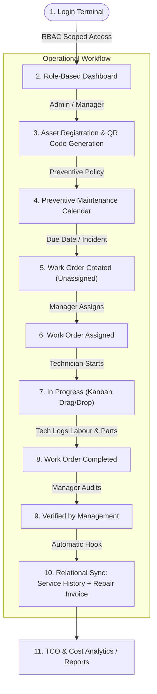

# 🛠️ Smart AssetCare
### *Enterprise Campus Capital Asset & Predictive Maintenance Management Platform*

[](https://react.dev/)
[](https://vitejs.dev/)
[](https://tailwindcss.com/)
[](https://nodejs.org/)
[](LICENSE)

---

## 📌 Overview

**Smart AssetCare** is a modern, high-reliability enterprise command console designed for universities, institutional research laboratories, and campus facilities. It unifies physical equipment inventory, predictive maintenance scheduling, work order dispatch, audit-compliant service logs, and equipment Total Cost of Ownership (TCO) tracking into a single client-side platform.

---

## ✨ Key Features

- 🛡️ **Role-Based Access Control (RBAC)**: Tailored dashboards and permissions for **Admins**, **Facility Managers**, **Field Technicians**, and **Staff**.
- 🏷️ **Asset Registry & Dynamic QR Codes**: Real-time generation of printable 512px SVG/Canvas QR codes for on-site physical equipment tagging.
- 📅 **Preventive Maintenance Calendar**: Interactive scheduling with recurrence cycles (weekly, monthly, quarterly) and automated overdue detection.
- 📋 **Work Order Kanban State Machine**: Drag-and-drop ticket lifecycle management (`Created` ➔ `Assigned` ➔ `In Progress` ➔ `Completed` ➔ `Verified` ➔ `Closed`) powered by `@dnd-kit`.
- 🔗 **Automated Relational Ledger Sync**: Verifying a work order automatically generates audit-ready service logs and financial repair invoices.
- 🤖 **Offline Smart Assistant**: Rule-based natural language query parser for instant equipment search, overdue alerts, and quick actions.
- 📊 **Executive Analytics & Reporting**: Interactive data visualizations (Recharts) for repair costs, asset health distribution, and CSV export.
- 💾 **Versioned LocalStorage Engine**: Zero-setup, client-side relational database persistence with instant factory seed data recovery.

---

## 🔄 System Workflow

The end-to-end lifecycle models real-world facilities operations from equipment onboarding to financial auditing:



---

## 💻 Tech Stack

| Layer | Technology | Version | Purpose |
| :--- | :--- | :--- | :--- |
| **Core Framework** | React | `^18.3.1` | Component-driven UI architecture with hooks and concurrent rendering |
| **Tooling & Bundler** | Vite | `^5.4.11` | Ultra-fast ES-module bundling, hot module replacement (HMR) |
| **Routing** | React Router DOM | `^6.28.0` | Declarative client-side routing and protected RBAC route guards |
| **Styling** | Tailwind CSS | `^3.4.15` | Industrial dark-theme utility system with custom CSS variables |
| **Drag & Drop** | @dnd-kit | `^6.1.0` | Accessible Kanban board drag-and-drop state transitions |
| **Visual Charts** | Recharts | `^2.13.3` | Responsive SVG area, bar, and pie charts with custom tooltips |
| **Animations** | Framer Motion | `^11.11.17` | Smooth modal dialogs, drawer slide-overs, and page transitions |
| **Iconography** | Lucide React | `^0.460.0` | Clean, accessible SVG vector icons |
| **QR Code Engine** | qrcode.react | `^4.1.0` | Dynamic SVG and Canvas PNG rendering for physical asset tags |
| **Date Utilities** | date-fns | `^4.1.0` | Calendar grid generation, recurrence calculation, and overdue comparisons |
| **Micro-Interactions** | canvas-confetti | `^1.9.3` | Milestone celebrations on work order verification |
| **Persistence** | Web Storage API | Native | Relational JSON schema storage in browser `localStorage` |

---

## 👥 Demo Accounts & Credentials

The application includes pre-configured demo personas with instant **one-click login** on the login page:

| Role | Demo User | Email | Password | Scope of Access |
| :--- | :--- | :--- | :--- | :--- |
| 👑 **Institutional Admin** | Dr. Ramesh Sharma | `admin@smartassetcare.demo` | `Demo123!` | Complete administrative authority, user management, factory data reset |
| 📋 **Facility Manager** | Vikram Malhotra | `manager@smartassetcare.demo` | `Demo123!` | Maintenance calendar, technician dispatch, ticket verification, cost auditing |
| 🔧 **Field Technician** | Rajesh Kumar | `technician@smartassetcare.demo` | `Demo123!` | Assigned work orders, parts & labor logging, technical note completion |
| 👤 **Faculty / Staff** | Prof. Anita Deshmukh | `staff@smartassetcare.demo` | `Demo123!` | Incident ticket reporting, equipment catalog search, personal request tracking |

---

## 🚀 Quick Start Guide

### Prerequisites
- **Node.js**: `v18.0.0` or higher (`v20+` recommended)
- **npm** or **pnpm**

### 1. Clone & Navigate
```bash
git clone https://github.com/your-username/smart-assetcare.git
cd smart-assetcare
```

### 2. Install Dependencies
```bash
npm --prefix frontend install
```

### 3. Start Development Server
```bash
npm run dev
```
Open **[http://localhost:5173/](http://localhost:5173/)** in your browser.

### 4. Build for Production
```bash
npm run build
```
Compiled assets will be placed in the `frontend/dist/` directory.

### 5. Run Automated E2E Verification Suite
```bash
node frontend/verify-e2e.js
```

---

## 🌐 Deployment (For Evaluation & Demos)

### Deploy on Vercel (Recommended)
1. Push your code to GitHub.
2. Import the repository on [Vercel](https://vercel.com).
3. Set **Root Directory** to `frontend`.
4. Deploy! *(The included `frontend/vercel.json` handles SPA client routing automatically).*

### Deploy on Netlify
- Drag and drop the `frontend/dist` folder directly onto [Netlify Drop](https://app.netlify.com/drop).
- *(The included `frontend/public/_redirects` ensures seamless page reloads on all nested routes).*

---

## 📁 Project Structure

```
smart-assetcare/
├── frontend/
│   ├── public/                 # Static assets, SVG favicon, _redirects
│   ├── src/
│   │   ├── components/         # Modular reusable components
│   │   │   ├── assistant/      # SmartAssistant drawer and query engine
│   │   │   ├── cards/          # MetricCard KPI widgets & Card wrappers
│   │   │   ├── charts/         # Recharts integration components
│   │   │   ├── common/         # Button, Badge, Tag UI elements
│   │   │   ├── forms/          # Form inputs (TextInput, SelectInput, SearchInput)
│   │   │   ├── modals/         # Confirmation & form dialogs
│   │   │   └── navigation/     # Sidebar, TopNav, PublicNavbar, PublicFooter
│   │   ├── context/            # React Context stores
│   │   │   ├── AppDataContext.jsx  # Relational entity store (Assets, Orders, Costs)
│   │   │   ├── AuthContext.jsx     # Session persistence & RBAC simulation
│   │   │   ├── ThemeContext.jsx    # Theme provider
│   │   │   └── ToastContext.jsx    # Notification toast manager
│   │   ├── data/
│   │   │   └── seedData.js     # Master demo seeds (Assets, Users, Tickets)
│   │   ├── pages/              # Domain views (Assets, WorkOrders, Costs, Reports, etc.)
│   │   ├── routes/             # AppRoutes and ProtectedRoute guards
│   │   ├── services/           # storageService.js (LocalStorage manager)
│   │   ├── styles/             # Tailwind globals.css, theme variables
│   │   └── utils/              # RBAC permissions, workOrderRules, dateHelpers
│   ├── package.json
│   ├── tailwind.config.js
│   ├── vite.config.js
│   └── vercel.json
├── PROJECT_DOCUMENTATION.md    # Comprehensive architectural specification
├── package.json                # Root orchestration scripts
└── README.md                   # Project overview & documentation
```

---

## 📜 Academic Attribution & License

Developed as an Academic Minor Project in **Software Engineering & Enterprise Information Systems**.  
Released under the [MIT License](LICENSE).
